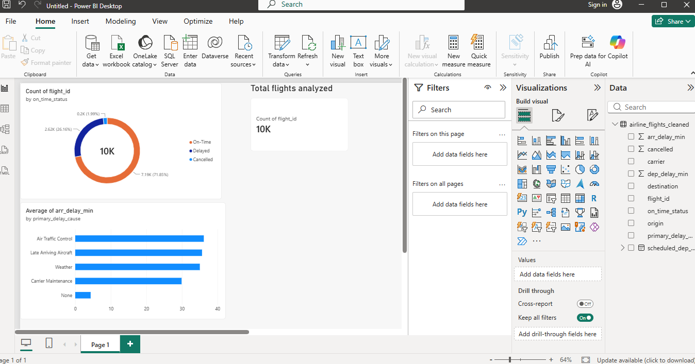

# Airline On-Time Performance & Flight Delay Analysis

#Executive Summary
Flight delays create cascading operational challenges, impacting crew rotations,gate utilization, and passenger satisfaction. This portfolio project investigates flight reliability metrics across major US domestic air carriers and hubs using a simulated dataset of 10,000 flight records. Key bottlenecks were isolated and tracked via an interactive executive dashboard.

#Tech Stack & Tools
Data Processing & ETL:Python (Pandas, NumPy)
Data Visualization:Power BI Desktop
Version Control:Git & GitHub

#Analytical Methodology
1.Data Ingestion & Hygiene:Generated structured flight records and handled missing values, ensuring departure and arrival airport codes remained distinct.
2.Operational Rules & Classification:Applied FAA standard criteria to classify arrival statuses (flights arriving within 15 minutes of scheduled time were categorized as `On-Time`).
3.Delay Root Cause Categorization:Grouped delays into core operational buckets (*Air Traffic Control*, *Late Arriving Aircraft*, *Weather*, and *Carrier Maintenance*).

#Key Findings
Primary Bottlenecks:Air Traffic Control holds and Late Arriving Aircraft accounted for the highest cumulative delay minutes.
Carrier Performance:Carriers demonstrated distinct reliability patterns, with regional evening flights experiencing higher cascading delays.
Peak Congestion Windows:Outbound afternoon and evening slots showed significantly elevated arrival delay averages.

#Executive Dashboard Preview

